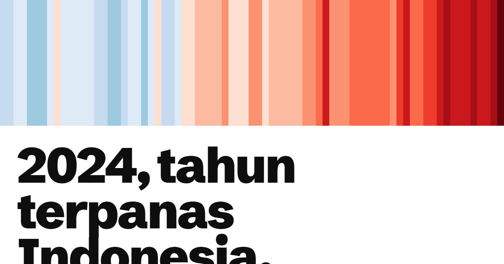

# Gerah



**[Buka Gerah](https://gerah.raffstw.my.id)**

Garis hangat Indonesia: suhu rata-rata seluruh wilayah Indonesia setiap tahun sejak 1950, dari
reanalisis ERA5. Biru lebih sejuk dan merah lebih panas daripada rata-rata 1961–1990.

- **Garis hangat**: satu garis per tahun, 1950–2024. 2024 adalah tahun terpanas (+1,6 °C), dan
  9 dari 10 tahun terpanas terjadi sejak 2015.
- **Sejak kamu lahir**: isi tahun lahir, lihat selisih suhu rata-rata lima tahun di sekitar
  tahun itu dengan lima tahun terakhir, plus hari panas dan malam tropis.
- **Setiap tahun**: anomali tahunan dengan garis tren (+0,23 °C per dekade). Tidak ada satu
  tahun pun sejak 1991 yang lebih sejuk dari rata-rata 1961–1990.
- **Kalender panas**: 900 bulan, masing-masing dibandingkan dengan bulan yang sama pada
  1961–1990. Sejak 2015, 120 dari 120 bulan lebih panas dari biasanya.
- **Hari panas dan malam tropis**: hari dengan suhu maksimum di atas 30 °C naik dari 62 (1950)
  menjadi 192 (2024).

## Data

`npm run data` mengunduh deret waktu tahunan dan bulanan ERA5 0,25° untuk Indonesia dari API
World Bank Climate Change Knowledge Portal (CCKP), lalu menyimpannya di `src/data/suhu.json`.

| Indikator | Arti |
|---|---|
| `tas` | suhu rata-rata harian |
| `tasmax`, `tasmin` | suhu maksimum dan minimum harian |
| `txx` | suhu maksimum tertinggi dalam setahun |
| `hd30`, `hd35` | jumlah hari dengan suhu maksimum di atas 30 °C dan 35 °C |
| `tr` | malam tropis, jumlah hari dengan suhu minimum di atas 20 °C |

Sumber: World Bank Climate Change Knowledge Portal; ERA5, Copernicus Climate Change Service.
Angkanya rata-rata seluruh grid, bukan catatan stasiun, jadi kota bisa jauh lebih panas. Untuk
data iklim resmi Indonesia, rujukannya BMKG.

## Warna

Garis hangat memakai skala divergen biru–merah gaya #ShowYourStripes karya Ed Hawkins
(University of Reading), dengan batas yang sama untuk semua grafik anomali.

## Menjalankan

```
npm install
npm run dev
npm test
npm run build
```
